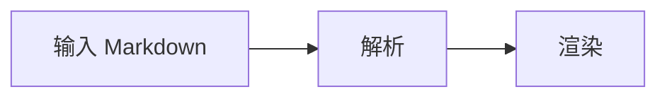

# Markdown 综合验收

本样例用于主编辑器、桌面便签和胶囊。源码显示完整标记；混合显示文字格式、图片和任务框；预览完整渲染。各模式切换后原文应保持一致。

## 01 标题

# 一级标题 H1
## 二级标题 H2
### 三级标题 H3
#### 四级标题 H4
##### 五级标题 H5
###### 六级标题 H6

Setext 一级
===========

Setext 二级
-----------

## 02 段落、强调、转义

普通中文 English 123 😀 🧑‍💻，标点「，。！？」与 **粗体**、*斜体*、__另一种粗体__、_另一种斜体_、~~删除线~~、***粗斜体***。

嵌套 **粗体里的 *斜体***，链接中的 [**粗体链接**](https://example.com)，以及行内代码 `const value = "**不加粗**";`。

转义 \*星号\*、\_下划线\_、\[方括号\]、实体 &amp; &lt; &gt; &#x1F600;。反斜线 \ 与反引号 `` `code` ``。

软换行第一行
软换行第二行。

硬换行第一行  
硬换行第二行。

## 03 普通列表和任务

- 普通无序列表一
- 普通无序列表二：**粗体**与 `code`
  - 嵌套无序列表
    - 第三层列表

1. 有序列表一
2. 有序列表二
   1. 嵌套有序列表
      - 混合嵌套列表

- [ ] 未完成任务 QA-OPEN
- [x] 已完成任务 QA-DONE
- [X] 大写标记任务 QA-UPPER
  - [ ] 嵌套任务 QA-NESTED
- [ ] 任务中有 **粗体**、*斜体*、[链接](https://example.com) 和 `code`

1. [ ] 有序任务 QA-ORDERED
2. [x] 有序已完成任务

> 引用里的任务：
> - [ ] 引用任务 QA-QUOTED
> - [x] 引用已完成任务

## 04 引用与提示块

> 普通引用第一行
> 引用第二行，含 **粗体**。
>
> > 嵌套引用。

> [!NOTE]
> NOTE 提示内容。

> [!TIP]
> TIP 建议内容。

> [!IMPORTANT]
> IMPORTANT 重要内容。

> [!WARNING]
> WARNING 警告内容。

> [!CAUTION]
> CAUTION 注意内容。

## 05 链接

[普通链接](https://example.com "示例标题")、<https://example.com>、自动链接 https://example.com/path?q=1 。

[引用式链接][qa-site]、[折叠链接][]。

[qa-site]: https://example.com "引用标题"
[折叠链接]: https://example.com/folded

## 06 图片

本地相对图片：


图片前文字  图片后文字 QA-IMAGE-AFTER。

引用式图片（应与直接图片一致）：

![引用图片][qa-image]

[qa-image]: images/markdown-qa.svg "引用图片标题"


## 07 表格

| 左对齐 | 居中 | 右对齐 |
| :--- | :---: | ---: |
| **粗体** | *斜体* | `code` |
| 中文与 😀 | a\|b | 123.45 |
| 很长的表格内容用于检查横向滚动与窄窗口布局 | 中间文字 | 最右内容 |

表格后文字 QA-TABLE-AFTER。

## 08 代码

行内代码 `a < b && b > c`。

```ts
// TypeScript 高亮与原样复制
const tasks: { title: string; done: boolean }[] = [
  { title: "Markdown", done: false },
];
console.log(tasks);
```

~~~python
# 波浪线围栏也应正确处理
print("**不会加粗**")
~~~

```text
- [ ] 代码里的任务不应变成复选框

$$ 不是公式 $$
```

```unknown-language
unknown <language> & literal **markers**
```

    缩进代码块
    - [x] 也不应变成复选框

## 09 数学公式

行内公式 $x^2+y^2=z^2$，金额字面量 `$5` 与转义 \$10。

$$
\int_0^1 x^2\,dx = \frac{1}{3}
$$

$$
A = \begin{bmatrix}1 & 2 \\ 3 & 4\end{bmatrix}
$$

公式后文字 QA-MATH-AFTER。

## 10 Mermaid



~~~mermaid
flowchart TD
    A[波浪线围栏] --> B[同样渲染]
~~~

图表后文字 QA-MERMAID-AFTER。

## 11 脚注与 HTML

正文带脚注[^qa]，另一处再次使用脚注[^qa]。

[^qa]: 脚注说明，含 **粗体** 和 [链接](https://example.com)。

默认 HTML 关闭时保留文本语义；主编辑器开启 HTML 设置后，应显示安全内容。

<details><summary>折叠 HTML 标题</summary><p>HTML 内容 <strong>加粗</strong> 和 H<sub>2</sub>O。</p></details>

HTML 字面量：<b>HTML 粗体标签</b>。

## 12 分割线和长文

---

分割线后的文字。

***

长段落混合中文 English 😀 用于检查换行、滚动、点击落点和较窄的胶囊窗口。长段落混合中文 English 😀 用于检查换行、滚动、点击落点和较窄的胶囊窗口。长段落混合中文 English 😀 用于检查换行、滚动、点击落点和较窄的胶囊窗口。长段落混合中文 English 😀 用于检查换行、滚动、点击落点和较窄的胶囊窗口。

文档末尾 QA-END。此处必须仍可见、可选、可编辑。
